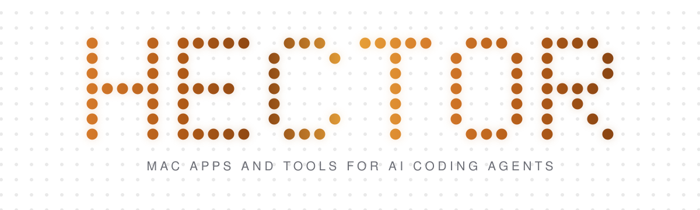

<picture>
  <source media="(prefers-color-scheme: dark)" srcset="banner-dark.svg">
  
</picture>

I build Mac apps and tools for AI coding agents. Almost everything here started as something I wanted on my own machine, so it gets used every day before it gets published.

### Cosmetics

One app that replaces the parts of macOS I kept fighting with. Configurable docks, an app launcher, a menu bar manager, a notch panel and a video wallpaper, with no dependencies and nothing phoning home.

**[Repository](https://github.com/CosmeticAura/cosmetics)**

### contextoptimize

A skill that shows you what is filling your context window before you have typed anything, then frees it. It measures memory files, skill and agent descriptions, plugins, hooks and MCP servers, gives you the five biggest costs with the tokens each fix saves, and applies only what you approve. Nothing is deleted, it moves to a dated archive.

**[Repository](https://github.com/CosmeticAura/contextoptimize)**

### Built with

